# OutbreakIQ: Database Entity Relationship Diagram (ERD) & Schema Specification

**Database Name:** `aurora_health`
**Platform:** PostgreSQL 14+ (production/Docker) / SQLite (zero-config local dev fallback)
**Hackathon:** SYNAPSE 2026 | **Problem Statement:** PS-021 (Early-Warning Community Outbreak Engine)

---

## 1. Visual Entity Relationship Diagram (Mermaid)

```mermaid
erDiagram
    REGIONS ||--o{ OBSERVATIONS : "aggregates"
    REGIONS ||--o{ ALERTS : "monitors"
    REGIONS ||--o{ INVESTIGATIONS : "jurisdiction"

    DATA_SOURCES ||--o{ OBSERVATIONS : "originates"
    DATA_SOURCES ||--o{ INGESTION_BATCHES : "receives"

    APP_USERS ||--o{ INGESTION_BATCHES : "ingests"
    APP_USERS ||--o{ ALERTS : "reviews"
    APP_USERS ||--o{ INVESTIGATIONS : "assigned_to / created_by"
    APP_USERS ||--o{ INVESTIGATION_EVENTS : "authors"
    APP_USERS ||--o{ AUDIT_LOGS : "actors"

    INGESTION_BATCHES ||--o{ OBSERVATIONS : "groups"

    ALERTS ||--o{ ALERT_EVIDENCE : "corroborates"
    ALERTS ||--o{ INVESTIGATIONS : "escalates_to"

    INVESTIGATIONS ||--o{ INVESTIGATION_EVENTS : "audit_timeline"

    REGIONS {
        VARCHAR_50 id PK "Jurisdiction identifier (e.g. REG-METRO-N)"
        VARCHAR_150 name "Human-readable jurisdiction name"
        VARCHAR_50 code UK "Unique region code (e.g. MN-01)"
        VARCHAR_50 parent_id "Hierarchical parent region"
        INTEGER population "Total monitored population"
        DOUBLE_PRECISION latitude "Geographic centroid latitude"
        DOUBLE_PRECISION longitude "Geographic centroid longitude"
        INTEGER active_alerts_count "Denormalized active alerts counter"
        INTEGER total_observations_count "Historical signal volume counter"
        DATE last_signal_date "Latest reporting date"
        TIMESTAMPTZ created_at "Record creation timestamp"
    }

    DATA_SOURCES {
        VARCHAR_50 id PK "Source feed identifier (e.g. SRC-SYNDROMIC-01)"
        VARCHAR_150 name "Feed display name"
        VARCHAR_50 source_type "EHR_EMERGENCY, PHARMACY_SALES, SENTINEL_CLINIC"
        VARCHAR_50 indicator "Primary symptom/syndrome indicator"
        VARCHAR_50 frequency "DAILY, HOURLY, WEEKLY"
        BOOLEAN is_active "Operational transmission status"
        BOOLEAN is_simulated "Flag for synthetic / validation feeds"
        TIMESTAMPTZ last_received_at "Timestamp of latest data packet"
        INTEGER facility_count "Number of participating facilities"
        TEXT coverage_notes "Contextual notes on feed scope"
        TIMESTAMPTZ created_at "Feed registration timestamp"
    }

    APP_USERS {
        VARCHAR_50 id PK "User UUID / identifier (e.g. USR-001)"
        VARCHAR_100 username UK "Unique system username"
        VARCHAR_255 hashed_password "PBKDF2-SHA256 password hash"
        VARCHAR_50 role "ADMIN, EPIDEMIOLOGIST, ANALYST, VIEWER"
        VARCHAR_150 full_name "User full name"
        VARCHAR_150 email UK "Official email address"
        BOOLEAN is_active "Account status flag"
        TIMESTAMPTZ created_at "User registration timestamp"
    }

    INGESTION_BATCHES {
        VARCHAR_50 id PK "Batch identifier (e.g. BATCH-2026-10-01)"
        VARCHAR_50 source_id FK "References data_sources(id)"
        VARCHAR_50 batch_type "SCHEDULED_FEED, MANUAL, API_PUSH"
        VARCHAR_50 status "COMPLETED, FAILED, PARTIAL"
        INTEGER records_received "Total records in transmission"
        INTEGER records_ingested "Successfully ingested count"
        INTEGER records_suppressed "Suppressed count (<5 rule)"
        VARCHAR_100 ingested_by FK "References app_users(username)"
        TEXT error_log "Validation errors or audit notes"
        TIMESTAMPTZ created_at "Ingestion timestamp"
    }

    OBSERVATIONS {
        VARCHAR_50 id PK "Observation identifier (e.g. OBS-...)"
        VARCHAR_50 region_id FK "References regions(id)"
        VARCHAR_50 indicator "Surveillance indicator (ILI, OTC, etc.)"
        DATE reporting_date "Date of observation incidence"
        INTEGER count "Raw unmasked count (internal only)"
        INTEGER effective_count "Privacy-masked count (NULL if < 5)"
        BOOLEAN is_suppressed "Privacy suppression flag"
        VARCHAR_50 source_id FK "References data_sources(id)"
        VARCHAR_50 batch_id FK "References ingestion_batches(id)"
        TEXT metadata_json "Extensible JSON metadata"
        TIMESTAMPTZ created_at "Ingestion timestamp"
    }

    ALERTS {
        VARCHAR_50 id PK "Alert identifier (e.g. ALT-2026-001)"
        VARCHAR_50 region_id FK "References regions(id)"
        VARCHAR_150 region_name "Denormalized region name"
        VARCHAR_50 indicator "Syndrome indicator"
        DATE reporting_date "Anomaly detection date"
        INTEGER observed_value "Observed incidence count"
        DOUBLE_PRECISION baseline_expected "Historical 7-day expected baseline"
        DOUBLE_PRECISION deviation_score "Z-score statistical deviation"
        VARCHAR_20 severity "CRITICAL, HIGH, MEDIUM, LOW"
        VARCHAR_20 confidence "HIGH, MEDIUM, LOW"
        TEXT explanation "Plain-language epidemiological explanation"
        TEXT evidence_summary "Summary of corroborating data points"
        TEXT data_quality_notes "Completeness & latency assessment"
        VARCHAR_50 review_status "PENDING_REVIEW, UNDER_INVESTIGATION, RESOLVED, DISMISSED"
        VARCHAR_100 reviewed_by FK "References app_users(username)"
        TIMESTAMPTZ reviewed_at "Triage review timestamp"
        TEXT review_notes "Analyst triage rationale"
        TIMESTAMPTZ created_at "Alert trigger timestamp"
        TIMESTAMPTZ updated_at "Last status update timestamp"
    }

    ALERT_EVIDENCE {
        VARCHAR_50 id PK "Evidence record identifier (e.g. EVD-001-A)"
        VARCHAR_50 alert_id FK "References alerts(id) ON DELETE CASCADE"
        VARCHAR_50 evidence_type "PHARMACY_SALES, SENTINEL_CLINIC, LAB_CONFIRMATION"
        VARCHAR_50 indicator "Corroborating signal indicator"
        VARCHAR_150 source_name "Name of corroborating data feed"
        VARCHAR_255 observed_trend "Trend description (e.g. +88% sales spike)"
        VARCHAR_20 signal_strength "STRONG, MODERATE, WEAK"
        BOOLEAN consistent_with_primary "True if corroborates primary anomaly"
        TEXT evidence_payload "Detailed telemetry JSON payload"
        TIMESTAMPTZ created_at "Evidence generation timestamp"
    }

    INVESTIGATIONS {
        VARCHAR_50 id PK "Case identifier (e.g. INV-2026-001)"
        VARCHAR_50 alert_id FK "References alerts(id) ON DELETE CASCADE"
        VARCHAR_250 title "Investigation title"
        VARCHAR_50 region_id FK "References regions(id)"
        VARCHAR_50 indicator "Syndrome indicator"
        VARCHAR_50 status "OPEN, IN_PROGRESS, RESOLVED, DISMISSED"
        VARCHAR_50 outcome "UNDER_EVALUATION, CORROBORATED, SPURIOUS_SIGNAL, CONTAINED"
        VARCHAR_100 assigned_to FK "References app_users(username)"
        VARCHAR_100 created_by FK "References app_users(username)"
        TEXT resolution_summary "Formal epidemiological conclusion"
        TIMESTAMPTZ created_at "Case opening timestamp"
        TIMESTAMPTZ updated_at "Case update timestamp"
    }

    INVESTIGATION_EVENTS {
        VARCHAR_50 id PK "Event identifier (e.g. EVT-001)"
        VARCHAR_50 investigation_id FK "References investigations(id) ON DELETE CASCADE"
        TIMESTAMPTZ timestamp "Chronological event timestamp"
        VARCHAR_100 author FK "References app_users(username)"
        VARCHAR_50 action "CREATED, STATUS_CHANGE, NOTE_ADDED, RESOLVED"
        TEXT details "Audit event narrative details"
    }

    AUDIT_LOGS {
        VARCHAR_50 id PK "Audit entry identifier (e.g. AUD-001)"
        TIMESTAMPTZ timestamp "Audit timestamp"
        VARCHAR_50 action "SYSTEM_INIT, TRIGGER_ALERT, TRIAGE_ALERT, CREATE_CASE, UPDATE_CASE"
        VARCHAR_100 actor_username FK "References app_users(username)"
        VARCHAR_50 target_entity "DATABASE, ALERT, INVESTIGATION, OBSERVATION"
        VARCHAR_50 target_id "Identifier of target entity"
        TEXT details "Compliance details and parameters"
    }
```



---

## 2. Core Relational Entities & Field Dictionary

| Entity | Primary Key | Key Foreign Keys | Key Constraints & Policies |
| :--- | :--- | :--- | :--- |
| **`regions`** | `id` (VARCHAR) | `parent_id` -> `regions.id` | `code` UNIQUE, `population > 0`, Geocoordinates (lat/lng) |
| **`data_sources`** | `id` (VARCHAR) | None | Operational status flags, facility count tracking |
| **`app_users`** | `id` (VARCHAR) | None | `username` UNIQUE, `email` UNIQUE, PBKDF2 hashed passwords, RBAC roles |
| **`ingestion_batches`** | `id` (VARCHAR) | `source_id` -> `data_sources.id`<br>`ingested_by` -> `app_users.username` | Tracks received, ingested, and suppressed counts |
| **`observations`** | `id` (VARCHAR) | `region_id` -> `regions.id`<br>`source_id` -> `data_sources.id`<br>`batch_id` -> `ingestion_batches.id` | **UNIQUE `(region_id, indicator, reporting_date, source_id)`**<br>**Count < 5 Privacy Rule**: `effective_count` is masked/NULL |
| **`alerts`** | `id` (VARCHAR) | `region_id` -> `regions.id`<br>`reviewed_by` -> `app_users.username` | Z-score statistical deviation, explainable narrative, severity & confidence rating |
| **`alert_evidence`** | `id` (VARCHAR) | `alert_id` -> `alerts.id` (CASCADE) | Independent corroborating telemetry, signal strength |
| **`investigations`** | `id` (VARCHAR) | `alert_id` -> `alerts.id` (CASCADE)<br>`region_id` -> `regions.id`<br>`assigned_to` -> `app_users.username` | Epidemiological case tracking, status transitions, outcome documentation |
| **`investigation_events`** | `id` (VARCHAR) | `investigation_id` -> `investigations.id` (CASCADE)<br>`author` -> `app_users.username` | Immutable chronological event log of analyst actions |
| **`audit_logs`** | `id` (VARCHAR) | `actor_username` -> `app_users.username` | Regulatory compliance audit trail |

---

## 3. Privacy & Compliance Layer

### Small-Cell Suppression Rule ($count < 5$)
In compliance with public health privacy standards (HIPAA de-identification & syndromic surveillance guidelines):
- Any cell where aggregate observations are less than 5 (`count < 5`) is considered a re-identification risk in small populations.
- `observations.is_suppressed` is set to `TRUE`.
- `observations.effective_count` is set to `NULL`.
- The database view `v_public_observations` enforces this unconditionally:
  ```sql
  CASE
      WHEN o.is_suppressed OR o.count < 5 THEN NULL
      ELSE o.effective_count
  END AS effective_count
  ```
- Public and stakeholder endpoints **never expose raw count** or totals from which suppressed values can be mathematically deduced.

---

## 4. Analytical Views

1. **`v_public_observations`**: Privacy-safe exposure of longitudinal surveillance observations joined with regional and feed metadata.
2. **`v_regional_summary`**: Aggregates active alert counts, total signal volume, and highest severity flag per geographic district.
3. **`v_active_alerts_detail`**: Joins alerts with an aggregate count of independent corroborating evidence signals.
4. **`v_investigation_cases`**: Combines open epidemiological cases with officer assignment names and timeline event tallies.
